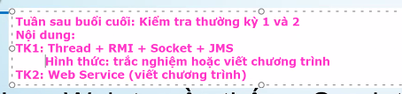
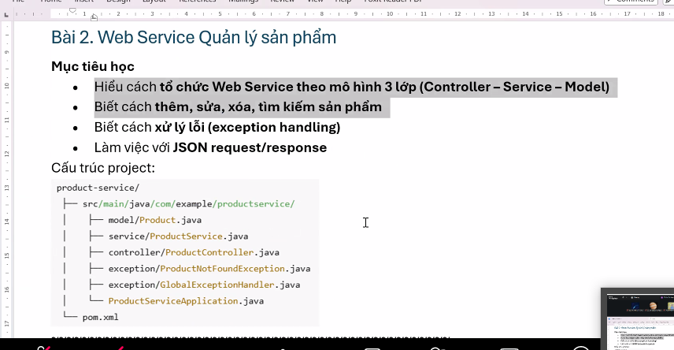
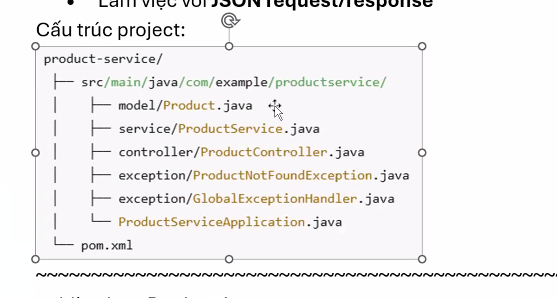

giữa kì
rmi tcp udp

thường kì 1
thread + rmi + socket + jms ; trắc nghiệm hoặc thực hành
thường kì 2

webservice , viết chương trình

cuối kì webservice

Nội dung thi Cuối kỳ là lý thuyết hệ thống phân tán (Bài 1) và Web Service (chương cuối).

giống bài tk2

b8

dùng curl test
