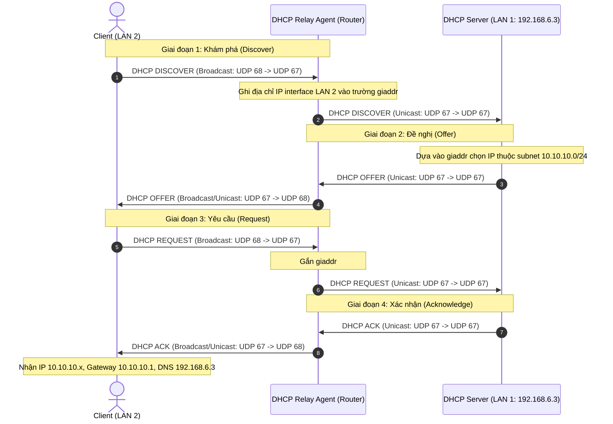

# ĐỀ THI GIỮA KỲ & LỜI GIẢI CHI TIẾT (LÝ THUYẾT + THỰC HÀNH)
## MÔN: QUẢN TRỊ DỊCH VỤ MẠNG - KHOA CNTT - ĐH CÔNG NGHIỆP TP.HCM (IUH)

---

# PHẦN 1: NỘI DUNG NGUYÊN VĂN ĐỀ THI

```text
TRƯỜNG ĐẠI HỌC CÔNG NGHIỆP THÀNH PHỐ HỒ CHÍ MINH
KHOA: CNTT
Mẫu 3a: Đề tự luận giữa kỳ
ĐỀ THI GIỮA KỲ
Môn thi: Quản trị dịch vụ mạng
Lớp/Lớp học phần: DHCNTT19A
Thời gian làm bài: 60 phút (Không kể thời gian phát đề)
(Đề thi được sử dụng tài liệu giấy)
```

### **Câu 1: (3 điểm, CLO 2)** Cho mô hình mạng như sau:

```text
       [Host A Windows] (192.168.5.1)
              |
=== Mạng 192.168.5.0/24 (LAN 1) =========================
         |                                  |
     (eth0: 192.168.5.2)                (eth1: 192.168.5.3)
      [ Linux A ]                        [ Linux B ]
     (eth1: 192.168.6.3)                (eth0: 192.168.6.2)
         |                                  |
=== Mạng 192.168.6.0/24 (LAN 2) =========================
              |
       [Host B Windows] (192.168.6.1)
```

**Xây dựng hệ thống mạng với yêu cầu sau:**
- **a.** Máy chủ tên Ubuntu server, địa chỉ IP là `192.168.6.3/24` (ping thông các máy).
- **b.** Ubuntu server là máy điều khiển miền `abc.edu.vn` đồng thời làm máy chủ phân giải tên miền.

---

### **Câu 2: (7 điểm)**
Công ty abc có 100 người làm việc trong 3 phòng ban gồm: Phòng kế toán, phòng nhân sự, phòng đào tạo, trang thiết bị mạng của công ty gồm có: 2 server, 100 máy tính để bàn, 15 máy tính xách tay, 10 máy in, 2 máy photo, scan, cùng một số thiết bị Switch, Router... và công ty đã thực hiện kết nối mạng nội bộ (mạng LAN). Sử dụng địa chỉ mạng là `192.168.6.0/24` (trong đề ghi `192.168.6.3/24`) và dãy địa chỉ dành riêng cho các Server và giám đốc từ `192.168.6.3` đến `192.168.6.40`.

Hệ thống mạng LAN của công ty được mở rộng thêm network thứ 2 (LAN 2) với địa chỉ mạng là `10.10.10.0/24` và được kết nối với hệ thống LAN ban đầu (LAN 1) thông qua một Router mềm. DHCP Server trên LAN 1 không cấp được IP cho các máy trong LAN 2.

**Yêu cầu:**
- **a. (2 điểm, CLO 1)** Hãy đưa ra giải pháp phù hợp để cấp địa chỉ IP động cho hệ thống mạng LAN.
- **b. (2 điểm, CLO 1)** Giải thích đầy đủ nguyên lý hoạt động của dịch vụ DHCP được sử dụng trong giải pháp bạn chọn.
- **c. (3 điểm, CLO 2)** Cài đặt và triển khai DHCP relay agent mà đã đưa ra giải pháp (*câu c làm trên máy tính*).

---
---

# PHẦN 2: BÀI LÀM LÝ THUYẾT CHI TIẾT (DÙNG ĐỂ CHÉP VÀO GIẤY THI)

## CÂU 2a: GIẢI PHÁP CẤP PHÁT ĐỊA CHỈ IP ĐỘNG CHO HỆ THỐNG MẠNG LAN (2 ĐIỂM)

### 1. Phân tích hiện trạng & Nguyên nhân lỗi
- **Hiện trạng:**
  - Mạng ban đầu (LAN 1): `192.168.6.0/24`, có DHCP Server đặt tại máy `192.168.6.3`.
  - Mạng mở rộng (LAN 2): `10.10.10.0/24`.
  - Hai phân đoạn mạng được kết nối với nhau thông qua một **Router mềm** (Linux Server có bật tính năng định tuyến `ip_forward`).
- **Nguyên nhân DHCP Server ở LAN 1 không cấp được IP cho LAN 2:**
  - Quá trình xin cấp phát IP ban đầu của máy trạm (DHCP Discover) sử dụng gói tin **Broadcast** tầng 2 (Địa chỉ MAC đích `FF:FF:FF:FF:FF:FF`) và tầng 3 (Địa chỉ IP đích `255.255.255.255`).
  - Theo nguyên lý hoạt động của thiết bị định tuyến (Router/Router mềm), Router có vai trò **phân tách Broadcast Domain** (miền quảng bá) nhằm chống bão mạng. Do đó, Router **mặc định sẽ drop (hủy bỏ) toàn bộ các gói tin Broadcast**, không chuyển tiếp các gói tin này sang mạng khác.
  - Hậu quả là gói tin DHCP Discover từ các máy trạm thuộc LAN 2 không bao giờ đến được DHCP Server ở LAN 1.

### 2. So sánh các phương án giải pháp

| Tiêu chí | Phương án 1: Đặt thêm 1 DHCP Server vật lý trên LAN 2 | Phương án 2: Triển khai DHCP Relay Agent trên Router mềm |
| :--- | :--- | :--- |
| **Kiến trúc** | Cài đặt và duy trì 1 máy chủ DHCP riêng biệt đặt tại phân đoạn mạng LAN 2. | Cài đặt dịch vụ **DHCP Relay Agent** trực tiếp lên Router mềm đang kết nối giữa LAN 1 và LAN 2. |
| **Chi phí phần cứng** | Tốn kém (cần đầu tư thêm 1 máy chủ vật lý hoặc tài nguyên máy ảo riêng cho LAN 2). | **Chi phí 0 đồng** (tận dụng ngay Router mềm sẵn có của hệ thống). |
| **Quản trị tập trung** | Kém (Quản trị viên phải cấu hình, sao lưu và bảo trì 2 máy chủ DHCP độc lập). | **Tối ưu 100%** (Quản lý tập trung tất cả các Scope IP tại một DHCP Server duy nhất trên LAN 1). |
| **Khả năng mở rộng** | Khó khăn khi tiếp tục mở rộng LAN 3, LAN 4... (mỗi nhánh mạng lại phải dựng thêm 1 server). | Rất dễ dàng (chỉ cần khai báo thêm Subnet trên DHCP Server chính và kích hoạt relay trên router nhánh đó). |

👉 **KẾT LUẬN GIẢI PHÁP CHỌN:**  
**Chọn Phương án 2: Triển khai giải pháp DHCP Relay Agent trên Router mềm.**  
Đây là giải pháp chuẩn công nghiệp (theo RFC 3046 / RFC 2131), tối ưu chi phí, hiệu năng cao và đáp ứng quản trị tập trung.

### 3. Thiết kế quy hoạch phân bổ địa chỉ IP (IP Addressing Plan)

#### A. Phân đoạn mạng LAN 1 (`192.168.6.0/24`)
- **Network ID:** `192.168.6.0/24` (Subnet mask: `255.255.255.0`)
- **Default Gateway:** `192.168.6.3`
- **DNS Server:** `192.168.6.3` (Domain: `abc.edu.vn`)
- **Dãy IP tĩnh dành riêng (Exclusion Range):** Từ `192.168.6.3` đến `192.168.6.40` (Dành cho 2 Server, Ban Giám Đốc, các thiết bị mạng Switch, Router, máy in, máy photo scan).
- **Dãy IP cấp phát động DHCP (DHCP Pool Range):** Từ `192.168.6.41` đến `192.168.6.254` (Cấp tự động cho các máy tính phòng Kế toán, Nhân sự, Đào tạo và laptop khách).
- **Default Lease Time:** 600 giây (10 phút); **Max Lease Time:** 7200 giây (2 giờ).

#### B. Phân đoạn mạng mở rộng LAN 2 (`10.10.10.0/24`)
- **Network ID:** `10.10.10.0/24` (Subnet mask: `255.255.255.0`)
- **Default Gateway:** `10.10.10.1` (IP của Interface Router mềm cắm vào LAN 2)
- **DNS Server:** `192.168.6.3`
- **Dãy IP cấp phát động DHCP:** Từ `10.10.10.10` đến `10.10.10.250`
- **Dãy IP tĩnh dự phòng:** `10.10.10.1` đến `10.10.10.9`

---

## CÂU 2b: NGUYÊN LÝ HOẠT ĐỘNG CỦA DỊCH VỤ DHCP VÀ DHCP RELAY AGENT (2 ĐIỂM)

### 1. Khái niệm & Cổng dịch vụ
- **DHCP (Dynamic Host Configuration Protocol):** Giao thức cấu hình máy chủ động tầng ứng dụng (Application Layer), hoạt động trên nền giao thức **UDP**:
  - **UDP Port 67:** Cổng lắng nghe của DHCP Server và DHCP Relay Agent.
  - **UDP Port 68:** Cổng của DHCP Client.

### 2. Tiến trình cấp phát IP qua DHCP Relay Agent (Quy trình 8 bước)



### 3. Giải thích chi tiết từng bước:

1. **Bước 1 - DHCP Discover (Client $\rightarrow$ Relay):**  
   Máy trạm trên LAN 2 chưa có IP, gửi gói tin `DHCPDISCOVER` dạng **Broadcast** (`255.255.255.255`) từ cổng `UDP 68` đến cổng `UDP 67`.
2. **Bước 2 - Relay Agent xử lý & chuyển tiếp (Relay $\rightarrow$ Server):**  
   Dịch vụ DHCP Relay Agent trên Router mềm nhận được gói Broadcast tại interface nối với LAN 2 (`10.10.10.1`). Relay Agent thực hiện:
   - Ghi địa chỉ IP của interface nhận gói (`10.10.10.1`) vào trường **`giaddr` (Gateway IP Address)** trong phần mào đầu (header) của gói DHCP.
   - Chuyển đổi gói tin từ **Broadcast thành Unicast**.
   - Gửi gói tin Unicast này thẳng đến địa chỉ IP của DHCP Server tại LAN 1 (`192.168.6.3`) qua cổng `UDP 67`.
3. **Bước 3 - DHCP Offer (Server $\rightarrow$ Relay):**  
   DHCP Server nhận gói Unicast. Nó kiểm tra trường `giaddr`:
   - Thấy `giaddr = 10.10.10.1`, Server nhận biết ngay máy trạm này thuộc dải mạng `10.10.10.0/24`.
   - Server tìm trong file cấu hình khối `subnet 10.10.10.0 netmask 255.255.255.0`, chọn ra một địa chỉ IP chưa sử dụng (ví dụ: `10.10.10.15`), kèm theo Subnet Mask, Default Gateway (`10.10.10.1`), DNS Server (`192.168.6.3`).
   - Server đóng gói `DHCPOFFER` và gửi **Unicast** trả về cho Relay Agent (`10.10.10.1`).
4. **Bước 4 - Relay chuyển tiếp Offer (Relay $\rightarrow$ Client):**  
   Relay Agent nhận `DHCPOFFER` từ Server, chuyển tiếp xuống cho Client trên nhánh LAN 2.
5. **Bước 5 - DHCP Request (Client $\rightarrow$ Relay):**  
   Client chấp nhận gói đề nghị, gửi lại `DHCPREQUEST` (Broadcast) thông báo chính thức xin sử dụng IP đó.
6. **Bước 6 - Relay chuyển tiếp Request (Relay $\rightarrow$ Server):**  
   Relay Agent bắt gói tin, tiếp tục chèn `giaddr = 10.10.10.1` và Unicast tới DHCP Server.
7. **Bước 7 - DHCP ACK (Server $\rightarrow$ Relay):**  
   DHCP Server lưu thông tin cấp phát vào cơ sở dữ liệu `dhcpd.leases` và gửi lại gói `DHCPACK` (Unicast) cho Relay Agent xác nhận.
8. **Bước 8 - Relay chuyển tiếp ACK (Relay $\rightarrow$ Client):**  
   Relay Agent chuyển tiếp gói `DHCPACK` tới Client. Client áp dụng địa chỉ IP `10.10.10.x` vào card mạng và hoàn tất quá trình cấu hình mạng.

---
---

# PHẦN 3: HƯỚNG DẪN CẤU HÌNH THỰC HÀNH TỪNG BƯỚC (CÂU 1 & CÂU 2c)

## BƯỚC 1: CẤU HÌNH IP VÀ BẬT ĐỊNH TUYẾN ROUTER (CÂU 1a)

### 1. Trên máy Ubuntu Server (Ubuntu 1 - `192.168.6.3` / `192.168.5.2`)
- **Kiểm tra card mạng:**
  - `ens37` (LAN 1): IP `192.168.5.2/24`
  - `ens41` (LAN 2): IP `192.168.6.3/24`
- **Bật tính năng Router (IP Forwarding):**
  ```bash
  sudo sysctl -w net.ipv4.ip_forward=1
  # Lưu vĩnh viễn vào /etc/sysctl.conf
  sudo sed -i 's/#net.ipv4.ip_forward=1/net.ipv4.ip_forward=1/' /etc/sysctl.conf
  ```

---

## BƯỚC 2: CẤU HÌNH DNS SERVER BIND9 CHO MIỀN `abc.edu.vn` (CÂU 1b)

### 1. Khai báo Zone trong `/etc/bind/named.conf.local`:
```bash
sudo nano /etc/bind/named.conf.local
```
Nội dung:
```named
// Forward Zone: abc.edu.vn
zone "abc.edu.vn" {
    type master;
    file "/etc/bind/db.abc.edu.vn";
};

// Reverse Zone: 192.168.6.x
zone "6.168.192.in-addr.arpa" {
    type master;
    file "/etc/bind/db.192.168.6";
};
```

### 2. Tạo File cơ sở dữ liệu Forward `/etc/bind/db.abc.edu.vn`:
```named
$TTL    604800
@       IN      SOA     ns.abc.edu.vn. admin.abc.edu.vn. (
                              2         ; Serial
                         604800         ; Refresh
                          86400         ; Retry
                        2419200         ; Expire
                         604800 )       ; Negative Cache TTL
;
@       IN      NS      ns.abc.edu.vn.
ns      IN      A       192.168.6.3
server  IN      A       192.168.6.3
@       IN      A       192.168.6.3
www     IN      CNAME   abc.edu.vn.
mail    IN      A       192.168.6.3
router  IN      A       192.168.6.3
```

### 3. Tạo File cơ sở dữ liệu Reverse `/etc/bind/db.192.168.6`:
```named
$TTL    604800
@       IN      SOA     ns.abc.edu.vn. admin.abc.edu.vn. (
                              2         ; Serial
                         604800         ; Refresh
                          86400         ; Retry
                        2419200         ; Expire
                         604800 )       ; Negative Cache TTL
;
@       IN      NS      ns.abc.edu.vn.
3       IN      PTR     ns.abc.edu.vn.
3       IN      PTR     server.abc.edu.vn.
3       IN      PTR     abc.edu.vn.
```

### 4. Kiểm tra cú pháp và khởi động lại DNS Server:
```bash
sudo named-checkconf
sudo named-checkzone abc.edu.vn /etc/bind/db.abc.edu.vn
sudo named-checkzone 6.168.192.in-addr.arpa /etc/bind/db.192.168.6
sudo systemctl restart bind9
```

### 5. Kiểm thử phân giải tên miền:
```bash
nslookup abc.edu.vn 127.0.0.1
nslookup www.abc.edu.vn 127.0.0.1
nslookup 192.168.6.3 127.0.0.1
```

---

## BƯỚC 3: CẤU HÌNH DHCP SERVER & DHCP RELAY AGENT (CÂU 2c)

### 1. Cấu hình DHCP Server (Trên máy Ubuntu 1 - `192.168.6.3`)

Mở file `/etc/dhcp/dhcpd.conf`:
```bash
sudo nano /etc/dhcp/dhcpd.conf
```
Nội dung cấu hình chuẩn:
```dhcpd
default-lease-time 600;
max-lease-time 7200;
authoritative;

# ==========================================
# 1. SUBNET LAN 1 (192.168.6.0/24)
# ==========================================
subnet 192.168.6.0 netmask 255.255.255.0 {
    # Dãy cấp phát động (tránh dải tĩnh 192.168.6.3 -> 192.168.6.40)
    range 192.168.6.41 192.168.6.254;
    option subnet-mask 255.255.255.0;
    option routers 192.168.6.3;
    option domain-name-servers 192.168.6.3, 8.8.8.8;
    option domain-name "abc.edu.vn";
}

# ==========================================
# 2. SUBNET LAN 2 (10.10.10.0/24) QUA RELAY
# ==========================================
subnet 10.10.10.0 netmask 255.255.255.0 {
    range 10.10.10.10 10.10.10.250;
    option subnet-mask 255.255.255.0;
    option routers 10.10.10.1;
    option domain-name-servers 192.168.6.3, 8.8.8.8;
    option domain-name "abc.edu.vn";
}

# Subnet phụ mạng NAT nếu có (để dhcpd không báo lỗi thiếu subnet ens33)
subnet 192.168.1.0 netmask 255.255.255.0 {
}

# Subnet phụ LAN 5 nếu có card ens37
subnet 192.168.5.0 netmask 255.255.255.0 {
    range 192.168.5.10 192.168.5.50;
    option routers 192.168.5.2;
}
```

Khai báo card mạng lắng nghe trong `/etc/default/isc-dhcp-server`:
```bash
sudo sed -i 's/INTERFACESv4=.*/INTERFACESv4="ens37 ens41"/' /etc/default/isc-dhcp-server
sudo systemctl restart isc-dhcp-server
```

---

### 2. Cấu hình DHCP Relay Agent (Trên Router Mềm / Ubuntu 2)

Cài đặt gói:
```bash
sudo apt update && sudo apt install -y isc-dhcp-relay
```

Cấu hình file `/etc/default/isc-dhcp-relay`:
```bash
# Địa chỉ IP của máy chủ DHCP Server chính
SERVERS="192.168.6.3"

# Các card mạng tham gia Relay (card nối tới DHCP Server và card nối tới Client)
INTERFACES="ens37 ens41"

OPTIONS=""
```

Khởi động lại dịch vụ:
```bash
sudo systemctl restart isc-dhcp-relay
sudo systemctl enable isc-dhcp-relay
```

Bật IP Forwarding trên Router:
```bash
sudo sysctl -w net.ipv4.ip_forward=1
```

---

### 3. Kiểm thử trên máy Client (Windows 7 hoặc Ubuntu Client)
- **Trên Windows 7:**
  ```cmd
  ipconfig /release
  ipconfig /renew
  ipconfig /all
  nslookup abc.edu.vn 192.168.6.3
  ping abc.edu.vn
  ```
- **Trên Ubuntu Client:**
  ```bash
  sudo dhclient -r
  sudo dhclient -v
  ip a
  dig @192.168.6.3 abc.edu.vn
  ```

---
---

# PHẦN 4: SCRIPT TỰ ĐỘNG HÓA TÙY BIẾN KHI THI (`auto_gk_exam.py`)

Khi đi thi, nếu giám thị thay đổi tên miền (ví dụ: `cntt.edu.vn`), địa chỉ IP máy chủ (ví dụ: `172.16.10.1`), dải mạng LAN 1, LAN 2... Bạn chỉ cần mở file script này, **sửa lại các tham số ở đầu file** rồi chạy 1 lệnh là toàn bộ 4 máy tự động cấu hình xong 100% trong 5 giây!

File script nằm tại: [auto_gk_exam.py](file:///d:/folder/rac/iuh/m%C3%B4n/hk1-4/quan-tri-dich-vu-mang/lab/GK/auto_gk_exam.py)
