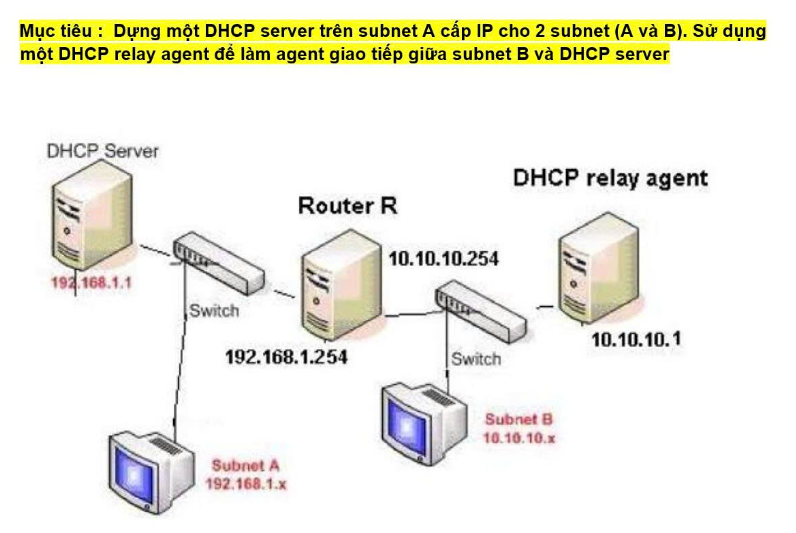
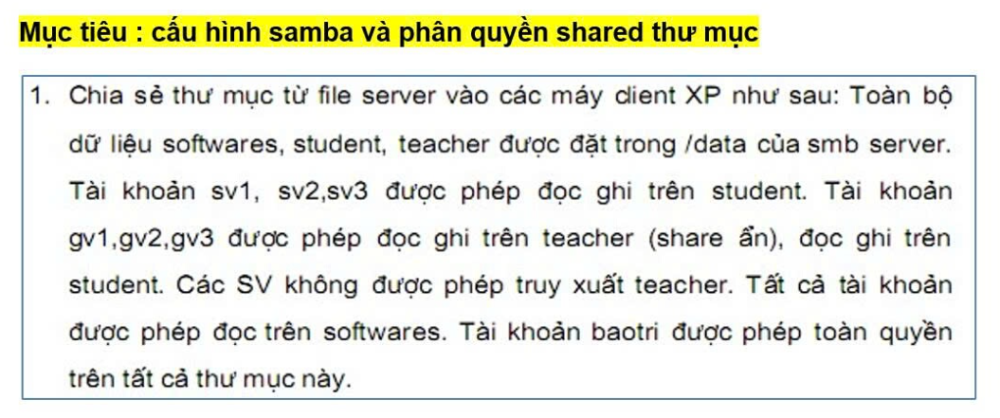
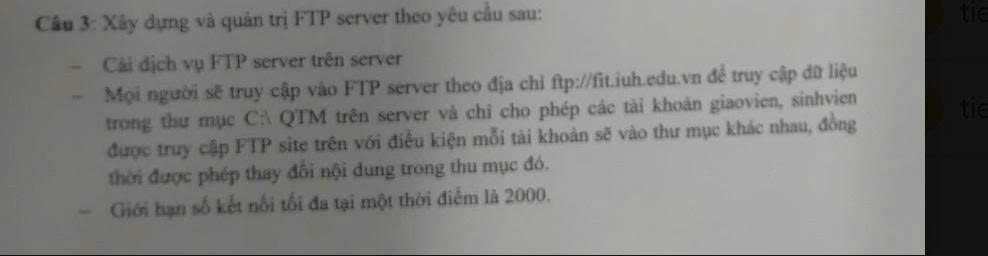

# ĐỀ BÀI KIỂM TRA THƯỜNG KỲ (TK) & HƯỚNG DẪN CẤU HÌNH CHI TIẾT

## MÔN: QUẢN TRỊ DỊCH VỤ MẠNG - KHOA CNTT - ĐH CÔNG NGHIỆP TP.HCM (IUH)

---

# PHẦN 1: NỘI DUNG NGUYÊN VĂN ĐỀ BÀI (CHUẨN 100% THEO ĐỀ)

## 📌 CÂU 1: DỊCH VỤ DHCP & DHCP RELAY AGENT (4 MÁY)

**Mục tiêu:** Dựng một DHCP server trên subnet A cấp IP cho 2 subnet (A và B). Sử dụng một DHCP relay agent để làm agent giao tiếp giữa subnet B và DHCP server.



### Sơ đồ mạng & Bảng phân bổ IP chính xác theo đề:

```text
       [ DHCP Server ] (192.168.1.1)
              |
=== Mạng Subnet A (192.168.1.0/24) ==========================
       |                                  |
 [ Client Subnet A ]               (192.168.1.254)
   (Win 7-1: 192.168.1.x)            [ Router R ]
                                   (10.10.10.254)
                                          |
=== Mạng Subnet B (10.10.10.0/24) ===========================
       |                                  |
 [ Client Subnet B ]             [ DHCP Relay Agent ]
   (Win 7-2: 10.10.10.x)               (10.10.10.1)
```

| Thiết bị / Máy ảo      | Tên máy tương ứng      | Vị trí mạng   | Card mạng VMware         | Địa chỉ IP chuẩn đề                                                                       | Vai trò chi tiết                                                                  |
| :------------------------- | :-------------------------- | :--------------- | :------------------------ | :---------------------------------------------------------------------------------------------- | :---------------------------------------------------------------------------------- |
| **DHCP Server**      | **Ubuntu 1**          | Subnet A         | `ens37` (`VMnet2`)    | **`192.168.1.1/24`**                                                                    | Cài `isc-dhcp-server`, cấp IP cho Subnet A và Subnet B                         |
| **Router R**         | **Ubuntu 1** (Router) | Cổng nối A & B | `ens37` & `ens41`     | • Nối Subnet A: **`192.168.1.254/24`**• Nối Subnet B: **`10.10.10.254/24`** | Bật `net.ipv4.ip_forward=1` làm Gateway liên mạng                             |
| **DHCP Relay Agent** | **Ubuntu 2**          | Subnet B         | `ens37` (`VMnet3`)    | **`10.10.10.1/24`**                                                                     | Cài `isc-dhcp-relay`, chuyển tiếp DHCP từ Subnet B về Server `192.168.1.1` |
| **Client Subnet A**  | **Win 7-1** (Host A)  | Subnet A         | `Local Area Connection` | **`192.168.1.x/24`** (DHCP)                                                             | Gateway: `192.168.1.254`, DNS: `192.168.1.1`                                    |
| **Client Subnet B**  | **Win 7-2** (Host B)  | Subnet B         | `Local Area Connection` | **`10.10.10.x/24`** (DHCP)                                                              | Gateway: `10.10.10.254`, DNS: `192.168.1.1`                                     |

---

## 📌 CÂU 2: CẤU HÌNH SAMBA SERVER VÀ PHÂN QUYỀN SHARED THƯ MỤC

**Mục tiêu:** Cấu hình Samba và phân quyền shared thư mục.



### Yêu cầu chi tiết:

1. **Cấu trúc thư mục:**
   * Toàn bộ dữ liệu `softwares`, `student`, `teacher` được đặt trong thư mục gốc `/data` của SMB Server (tức `/data/softwares`, `/data/student`, `/data/teacher`).
2. **Danh sách người dùng và nhóm:**
   * Nhóm Sinh viên: `sv1`, `sv2`, `sv3`
   * Nhóm Giáo viên: `gv1`, `gv2`, `gv3`
   * Người bảo trì: `baotri`
3. **Chính sách phân quyền:**
   * **Thư mục `student` (`/data/student`):**
     * Tài khoản `sv1`, `sv2`, `sv3`: Được phép **đọc ghi** (Read/Write).
     * Tài khoản `gv1`, `gv2`, `gv3`: Được phép **đọc ghi** (Read/Write).
     * Tài khoản `baotri`: Được phép **toàn quyền**.
   * **Thư mục `teacher` (`/data/teacher`) — SHARE ẨN (`teacher$`):**
     * Tài khoản `gv1`, `gv2`, `gv3`: Được phép **đọc ghi** (Read/Write).
     * Tài khoản `baotri`: Được phép **toàn quyền**.
     * **Các SV (`sv1`, `sv2`, `sv3`) tuyệt đối KHÔNG được phép truy xuất `teacher`**.
   * **Thư mục `softwares` (`/data/softwares`):**
     * **Tất cả tài khoản** (SV, GV): Được phép **ĐỌC** (Read-only).
     * Tài khoản `baotri`: Được phép **toàn quyền** (Read/Write).
   * **Tài khoản `baotri`:** Có **toàn quyền** trên tất cả các thư mục này.

---

## 📌 CÂU 3: XÂY DỰNG VÀ QUẢN TRỊ FTP SERVER

**Mục tiêu:** Xây dựng và quản trị FTP Server.



### Yêu cầu chi tiết:

1. **Cài đặt dịch vụ:** Cài dịch vụ FTP Server trên Server (`vsftpd`).
2. **Tên miền truy cập:**
   * Mọi người sẽ truy cập vào FTP Server theo địa chỉ: **`ftp://fit.iuh.edu.vn`** (Cần cấu hình DNS BIND9 phân giải tên miền `fit.iuh.edu.vn` về IP của FTP Server).
3. **Phân quyền và cô lập người dùng (User Isolation):**
   * Truy cập dữ liệu trong thư mục trên server.
   * Chỉ cho phép các tài khoản: **`giaovien`**, **`sinhvien`** được truy cập FTP site trên.
   * **Điều kiện:** Mỗi tài khoản sẽ vào một thư mục khác nhau, đồng thời được phép thay đổi nội dung (Đọc/Ghi) trong thư mục đó.
4. **Giới hạn tải:**
   * Giới hạn số kết nối tối đa tại một thời điểm là **`2000`** (`max_clients=2000`).

---

---

# PHẦN 2: HƯỚNG DẪN CẤU HÌNH TỰ ĐỘNG & THỦ CÔNG CHI TIẾT

## 🚀 1. CẤU HÌNH CÂU 1: IP VÀ DHCP THEO ĐÚNG ĐỀ

### Trên Ubuntu 1 (DHCP Server & Router R):

* Gán IP cho card `ens37` (Subnet A): `192.168.1.1/24` và alias `192.168.1.254/24`
* Gán IP cho card `ens41` (Subnet B): `10.10.10.254/24`
* Bật chuyển tiếp gói tin: `sudo sysctl -w net.ipv4.ip_forward=1`
* Cấu hình `/etc/dhcp/dhcpd.conf`:

```dhcpd
default-lease-time 600;
max-lease-time 7200;
authoritative;

# Subnet A (192.168.1.0/24)
subnet 192.168.1.0 netmask 255.255.255.0 {
    range 192.168.1.10 192.168.1.100;
    option routers 192.168.1.254;
    option domain-name-servers 192.168.1.1;
    option domain-name "fit.iuh.edu.vn";
}

# Subnet B (10.10.10.0/24)
subnet 10.10.10.0 netmask 255.255.255.0 {
    range 10.10.10.10 10.10.10.100;
    option routers 10.10.10.254;
    option domain-name-servers 192.168.1.1;
    option domain-name "fit.iuh.edu.vn";
}
```

### Trên Ubuntu 2 (DHCP Relay Agent):

* Gán IP cho card `ens37` (Subnet B): `10.10.10.1/24`
* Khai báo trong `/etc/default/isc-dhcp-relay`:
  * `SERVERS="192.168.1.1"`
  * `INTERFACES="ens37"`

---

## 🚀 2. CẤU HÌNH CÂU 2: SAMBA SERVER (/data)

### Trên Ubuntu Server:

1. Tạo thư mục:

```bash
sudo mkdir -p /data/softwares /data/student /data/teacher
```

2. Tạo file mẫu kiểm tra:

```bash
sudo echo "Software Repository - Read Only" > /data/softwares/soft_readme.txt
sudo echo "Student Data - SV & GV & Baotri RW" > /data/student/student_info.txt
sudo echo "Teacher Data - GV & Baotri RW (Hidden)" > /data/teacher/teacher_exam.txt
```

3. Tạo nhóm & người dùng Samba:

```bash
sudo groupadd students
sudo groupadd teachers

for u in sv1 sv2 sv3; do
    sudo useradd -M -s /sbin/nologin -g students $u 2>/dev/null || true
    echo -e "123\n123" | sudo smbpasswd -a -s $u
done

for u in gv1 gv2 gv3; do
    sudo useradd -M -s /sbin/nologin -g teachers $u 2>/dev/null || true
    echo -e "123\n123" | sudo smbpasswd -a -s $u
done

sudo useradd -M -s /sbin/nologin baotri 2>/dev/null || true
echo -e "123\n123" | sudo smbpasswd -a -s baotri
```

4. Phân quyền Linux:

```bash
sudo chown -R baotri:students /data/student; sudo chmod -R 777 /data/student
sudo chown -R baotri:teachers /data/teacher; sudo chmod -R 770 /data/teacher
sudo chown -R baotri:root /data/softwares; sudo chmod -R 755 /data/softwares
```

5. Cấu hình `/etc/samba/smb.conf`:

```ini
[student]
    comment = Du lieu Sinh Vien
    path = /data/student
    browseable = yes
    read only = no
    valid users = @students, @teachers, baotri
    write list = @students, @teachers, baotri
    create mask = 0777
    directory mask = 0777

[teacher$]
    comment = Du lieu Giao Vien (Share An)
    path = /data/teacher
    browseable = no
    read only = no
    valid users = @teachers, baotri
    write list = @teachers, baotri
    create mask = 0770
    directory mask = 0770

[softwares]
    comment = Kho Phan Mem Dung Chung
    path = /data/softwares
    browseable = yes
    read only = yes
    valid users = @students, @teachers, baotri
    write list = baotri
```

6. Khởi động lại Samba:

```bash
sudo systemctl restart smbd nmbd
```

---

## 🚀 3. CẤU HÌNH CÂU 3: FTP VSFTPD (fit.iuh.edu.vn)

1. Cấu hình DNS `fit.iuh.edu.vn` trỏ về địa chỉ IP của Server: **`192.168.1.1`**.
2. Tạo thư mục cô lập từng user FTP:

```bash
sudo mkdir -p /data/QTM/giaovien /data/QTM/sinhvien
sudo useradd -d /data/QTM/giaovien -s /bin/bash giaovien 2>/dev/null || true
echo "giaovien:123" | sudo chpasswd
sudo chown -R giaovien:giaovien /data/QTM/giaovien

sudo useradd -d /data/QTM/sinhvien -s /bin/bash sinhvien 2>/dev/null || true
echo "sinhvien:123" | sudo chpasswd
sudo chown -R sinhvien:sinhvien /data/QTM/sinhvien
```

3. Cấu hình `/etc/vsftpd.conf`:

```ini
listen=YES
listen_ipv6=NO
anonymous_enable=NO
local_enable=YES
write_enable=YES
chroot_local_user=YES
allow_writeable_chroot=YES
max_clients=2000
```

4. Khởi động lại:

```bash
sudo systemctl restart vsftpd
```

---

# PHẦN 3: HƯỚNG DẪN DEMO NHANH CHO GIẢNG VIÊN TRÊN DESKTOP WINDOWS 7

Toàn bộ 5 file kịch bản tự động đã được đưa thẳng lên màn hình **Desktop** của cả 2 máy **Win 7-1 (Subnet A)** và **Win 7-2 (Subnet B)**:

| Tên File Batch trên Desktop | Mục đích & Thao tác | Kết quả hiển thị đúng theo đề |
| :--- | :--- | :--- |
| **`1_CHUYEN_SANG_DHCP.bat`** | Chuyển máy sang nhận IP động từ DHCP Server / Relay Agent | • **Win 7-1**: Nhận IP `192.168.1.10 - 100`, GW: `192.168.1.254`, DNS: `192.168.1.1`<br>• **Win 7-2**: Nhận IP `10.10.10.10 - 100`, GW: `10.10.10.254`, DNS: `192.168.1.1` |
| **`2_CHUYEN_SANG_IP_TINH_CHUAN_DE.bat`** | Đặt IP tĩnh đúng 100% theo sơ đồ bài thi nếu giáo viên yêu cầu kiểm tra cấu hình tĩnh | • **Win 7-1**: `192.168.1.10`, Mask: `255.255.255.0`, GW: `192.168.1.254`, DNS: `192.168.1.1`<br>• **Win 7-2**: `10.10.10.10`, Mask: `255.255.255.0`, GW: `10.10.10.254`, DNS: `192.168.1.1` |
| **`3_TEST_KET_NOI_TOAN_MANG.bat`** | Kiểm tra thông mạng 4 máy và phân giải tên miền DNS | • Ping thành công: `192.168.1.1`, `192.168.1.254`, `10.10.10.254`, `10.10.10.1`<br>• Phân giải DNS: `nslookup fit.iuh.edu.vn` ra đúng `192.168.1.1` |
| **`4_DEMO_CAU2_SAMBA.bat`** | Kiểm tra tự động toàn bộ phân quyền chia sẻ thư mục Câu 2 | • `sv1` vào `student` (Đọc/Ghi thành công)<br>• `sv1` vào `softwares` (Chỉ đọc, ghi bị chặn)<br>• `sv1` vào `teacher$` (Bị từ chối Access Denied)<br>• `gv1` vào `teacher$` (Đọc/Ghi thành công)<br>• `baotri` toàn quyền |
| **`5_DEMO_CAU3_FTP.bat`** | Kiểm tra kết nối FTP Server Câu 3 theo tên miền `fit.iuh.edu.vn` | • Đăng nhập tài khoản `giaovien` (thấy `tailieu_giaovien.txt`)<br>• Đăng nhập tài khoản `sinhvien` (thấy `baitap_sinhvien.txt`)<br>• Kiểm tra cô lập thư mục (Chroot) và tải `max_clients=2000` |

