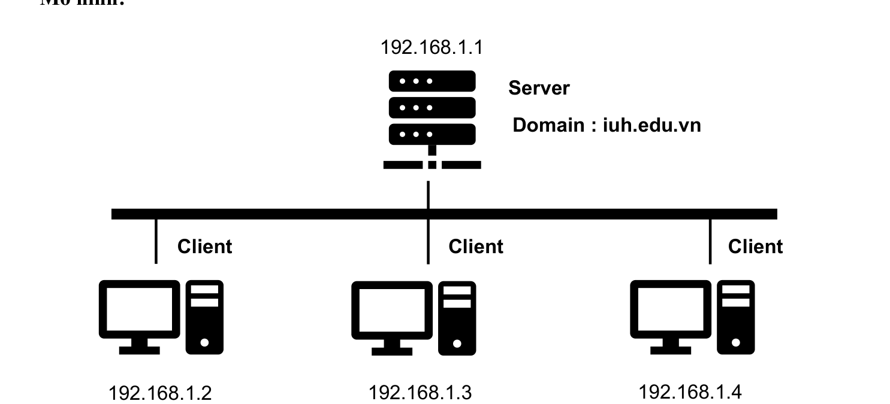
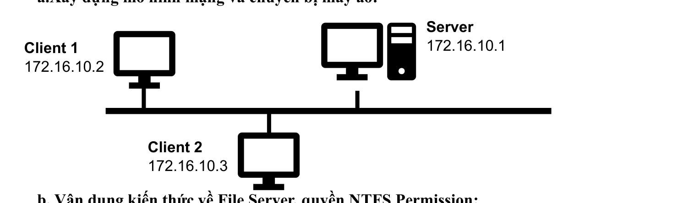
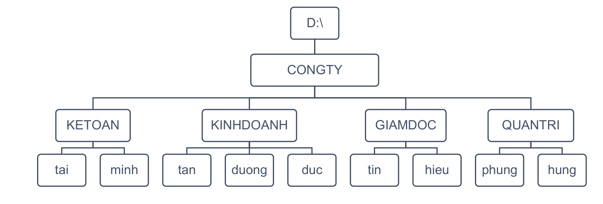
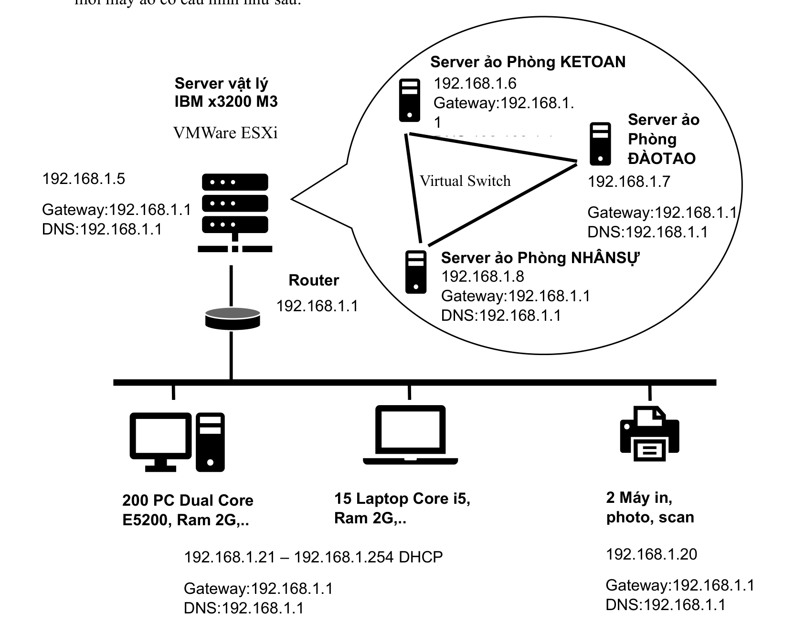

# CÂU 1: VẬN DỤNG KIẾN THỨC VỀ QUẢN TRỊ HỆ THỐNG ĐỂ XÁC ĐỊNH CÁC GIẢI PHÁP LIÊN QUAN ĐẾN:

## PHẦN 1. QUẢN TRỊ DOMAIN

### a. Mô hình mạng



#### [KHUNG SƠ ĐỒ VẼ TAY VÀO BÀI THI]

```text
                  +--------------------------------+
                  |             Server             |
                  |         IP: 192.168.1.1        |
                  |       Domain: iuh.edu.vn       |
                  +---------------+----------------+
                                  |
    ==============================+============================== (Bus / Switch)
            |                     |                     |
    +-------+-------+     +-------+-------+     +-------+-------+
    |    Client     |     |    Client     |     |    Client     |
    |  192.168.1.2  |     |  192.168.1.3  |     |  192.168.1.4  |
    +---------------+     +---------------+     +---------------+
```

---

### b. Vận dụng kiến thức về quản trị domain

Các phương pháp và công cụ quản trị hệ thống cốt lõi:

1. **Thiết lập & quản lý Domain Controller (DC):** Cài đặt Active Directory Domain Services (AD-DS) để quản lý tập trung cơ sở dữ liệu người dùng, nhóm và các chính sách bảo mật toàn mạng.
2. **Quản lý người dùng và nhóm (User & Group):** Khởi tạo tài khoản và nhóm theo phòng ban, phân quyền truy cập tương ứng nhằm kiểm soát tài nguyên và tăng tính bảo mật.
3. **Cấu hình chính sách bảo mật (Group Policy - GPO):** Thiết lập quy định mật khẩu phức tạp, khóa tài khoản khi đăng nhập sai, giới hạn quyền thay đổi cài đặt hệ thống.
4. **Phân phối phần mềm & cấp phát tài nguyên:** Tự động cài đặt phần mềm cho máy trạm qua GPO; giới hạn dung lượng ổ đĩa (Disk Quota) và chặn file cấm (File Screening) bằng FSRM.
5. **Giám sát & bảo trì hệ thống:** Sử dụng Event Viewer kiểm tra nhật ký lỗi/bảo mật, dùng Performance Monitor theo dõi tài nguyên phần cứng, định kỳ sao lưu System State.
6. **Đào tạo người dùng & quản trị viên:** Hướng dẫn người dùng đặt mật khẩu an toàn và đăng nhập domain; đào tạo IT kỹ năng quản trị AD, GPO và sao lưu phục hồi.

---

### c. Xác định các giải pháp thực hiện (Trên Windows Server 2019)

#### 1. Thiết lập máy chủ Domain Controller:

- Đặt IP tĩnh cho Server (`192.168.1.1/24`), trỏ Preferred DNS về `127.0.0.1`.
- Cài đặt tính năng **AD-DS (Active Directory Domain Services)** qua Server Manager.
- Nâng cấp Server lên DC (`Promote this server to a domain controller`) $\rightarrow$ Tạo Forest mới tên `iuh.edu.vn`.
- Đặt IP tĩnh cho các máy Client (`192.168.1.2`, `.3`, `.4`), trỏ DNS về `192.168.1.1` rồi tiến hành Join Domain.

#### 2. Quản lý người dùng và nhóm:

- Mở **Active Directory Users and Computers** (`dsa.msc`).
- Tạo các đơn vị tổ chức **OU (Organizational Unit)** theo từng phòng ban.
- Tạo các nhóm bảo mật (**Group**) và tài khoản người dùng (**User**); đưa User vào Group tương ứng.

#### 3. Cấu hình chính sách bảo mật qua Group Policy (GPO):

- **Cho phép User đăng nhập trực tiếp trên máy DC:**`Default Domain Controllers Policy` $\rightarrow$ `Edit` $\rightarrow$ `Computer Configuration` $\rightarrow$ `Policies` $\rightarrow$ `Windows Settings` $\rightarrow$ `Security Settings` $\rightarrow$ `Local Policies` $\rightarrow$ `User Rights Assignment` $\rightarrow$ `Allow log on locally` $\rightarrow$ Add User được phép $\rightarrow$ Chạy lệnh `gpupdate /force`.
- **Cấu hình chính sách mật khẩu toàn miền:**
  `Default Domain Policy` $\rightarrow$ `Edit` $\rightarrow$ `Computer Configuration` $\rightarrow$ `Policies` $\rightarrow$ `Windows Settings` $\rightarrow$ `Security Settings` $\rightarrow$ `Account Policies` $\rightarrow$ `Password Policy` $\rightarrow$ Bật yêu cầu phức tạp (`Complexity`), đặt độ dài tối thiểu $\ge 8$ ký tự $\rightarrow$ Chạy lệnh `gpupdate /force`.

#### 4. Phân phối phần mềm và quản lý tài nguyên:

- **Deploy Software tự động qua GPO:**Tạo GPO mới $\rightarrow$ `User Configuration` $\rightarrow$ `Policies` $\rightarrow$ `Software Settings` $\rightarrow$ `Software Installation` $\rightarrow$ `New` $\rightarrow$ `Package` (chọn đường dẫn chia sẻ mạng file cài đặt) $\rightarrow$ Gán (Link) GPO vào OU mong muốn $\rightarrow$ `gpupdate /force`.
- **Cấp phát tài nguyên bằng File Server Resource Manager (FSRM):**
  - *Giới hạn dung lượng (Disk Quota):* `FSRM` $\rightarrow$ `Quota Management` $\rightarrow$ `Quotas` $\rightarrow$ `Create Quota` $\rightarrow$ Chọn thư mục và đặt giới hạn dung lượng (Hard/Soft quota).
  - *Chặn định dạng file cấm (File Screening):* `FSRM` $\rightarrow$ `File Screening Management` $\rightarrow$ `File Screens` $\rightarrow$ `Create File Screen` $\rightarrow$ Chọn nhóm file cấm (Audio, Video, Executable) để ngăn chặn người dùng lưu trữ file không hợp lệ.

#### 5. Giám sát, bảo trì và đào tạo:

- **Giám sát:** Mở `Event Viewer` theo dõi System/Security logs; dùng `Performance Monitor` giám sát CPU/RAM máy chủ.
- **Bảo trì:** Định kỳ sao lưu trạng thái hệ thống (`System State`) bằng công cụ `Windows Server Backup`.
- **Đào tạo:** Ban hành chính sách đổi mật khẩu định kỳ 90 ngày cho User; chuẩn hóa quy trình phân quyền OU cho IT.

---

### d. Triển khai hệ thống (4 bước tóm tắt)

1. **Bước 1:** Đặt IP tĩnh Server `192.168.1.1`, cài Role AD-DS, Promote Forest mới `iuh.edu.vn`.
2. **Bước 2:** Mở `dsa.msc`, tạo các OU phòng ban, tạo Group và tạo User.
3. **Bước 3:** Mở `gpmc.msc`, cấu hình Password Policy & Allow log on locally, chạy `gpupdate /force`.
4. **Bước 4:** Đặt IP Client, trỏ DNS về `192.168.1.1`, Join Domain và khởi động lại máy trạm.

---

---

## PHẦN 2. BACKUP VÀ RESTORE HỆ THỐNG

### a. Mô hình mạng


#### [KHUNG SƠ ĐỒ VẼ TAY VÀO BÀI THI]

```text
    +---------------+         Backup (Sao lưu)        +-----------------------+
    |               |  ============================>  |                       |
    |  Server Data  |                                 |  Backup Data Storage  |
    |               |  <============================  |                       |
    +---------------+        Restore (Khôi phục)      +-----------------------+
```

*\* Nơi lưu trữ (Backup Data Storage) có thể là ổ cứng cục bộ trên Server hoặc thư mục chia sẻ qua mạng.*

---

### b. Vận dụng kiến thức về Backup & Restore

- **Sao lưu hệ thống (System Backup):** Tạo bản sao lưu an toàn của dữ liệu và cấu hình hệ thống máy chủ, lưu tại nơi biệt lập nhằm dự phòng khi có thảm họa.
- **Khôi phục hệ thống (System Restore):** Sử dụng các bản sao lưu đã tạo để phục hồi toàn bộ dữ liệu hoặc một phần hệ thống về trạng thái hoạt động bình thường.
- **Vai trò:** Đảm bảo an toàn và tính sẵn sàng cao của dữ liệu, giảm thiểu thời gian chết (downtime) của doanh nghiệp khi xảy ra sự cố phần cứng hoặc virus tấn công.

---

### c. Xác định giải pháp thực hiện (Trên Windows Server 2019)

1. Xác định dữ liệu cần sao lưu: Toàn bộ máy chủ (`Full Server`) hoặc thư mục quan trọng (`C:\`, `D:\`).
2. Xác định đích lưu trữ: Ổ đĩa chuyên dụng riêng biệt hoặc thư mục mạng chia sẻ (`\\IP\BackupData`).
3. Cấu hình chia sẻ thư mục đích qua mạng: Gán quyền Share `Everyone: Full Control`.
4. Cài đặt và cấu hình tính năng **Windows Server Backup**.

---

### d. Triển khai hệ thống (Các bước thực hiện)

1. **Cài đặt tính năng:**`Server Manager` $\rightarrow$ `Add Roles and Features` $\rightarrow$ `Features` $\rightarrow$ Tích chọn `Windows Server Backup` $\rightarrow$ `Install`.
2. **Sao lưu ngay một lần (Backup Once):**Mở `Windows Server Backup` $\rightarrow$ Chọn `Local Backup` $\rightarrow$ `Action` $\rightarrow$ `Backup Once` $\rightarrow$ Chọn `Different options` $\rightarrow$ Chọn `Full server` $\rightarrow$ Chọn `Remote shared folder` (nhập đường dẫn mạng và tài khoản có quyền ghi) $\rightarrow$ Nhấp `Backup`.
3. **Lên lịch sao lưu tự động định kỳ (Backup Schedule):**`Action` $\rightarrow$ `Backup Schedule` $\rightarrow$ Chọn `Full server` $\rightarrow$ Chọn thời gian sao lưu hàng ngày (`Once a day`, ví dụ 23:00) $\rightarrow$ Chọn đích lưu trữ $\rightarrow$ Nhấp `Finish`.
4. **Khôi phục dữ liệu (Recovery):**
   `Action` $\rightarrow$ `Recovery` $\rightarrow$ Chọn vị trí bản sao lưu (`This server` hoặc qua mạng) $\rightarrow$ Chọn thời điểm cần phục hồi $\rightarrow$ Chọn loại phục hồi (Files/Folders hoặc System State) $\rightarrow$ Chọn vị trí phục hồi $\rightarrow$ Nhấp `Recover`.

---

---

## PHẦN 3. FILE SERVER (BÀI TOÁN CÔNG TY ABC)

### Đề bài tóm tắt

Công ty ABC gồm 4 phòng ban:

- **Kế toán:** Nguyễn Văn Tài, Trần Thị Minh.
- **Kinh doanh:** Lê An Tân, Nguyễn Trúc Dương, Nguyễn Tuấn Đức và 50 nhân viên bán hàng.
- **Giám đốc:** Nguyễn Văn Tín, Đặng Văn Hiệu.
- **Quản trị (IT):** Đặng Công Phụng, Nguyễn Phúc Hưng.

**5 Yêu cầu chia sẻ & phân quyền:**

1. Thư mục cha `Congty` chia sẻ cho mọi người trong mạng truy cập.
2. Thư mục phòng ban nào chỉ nhân viên phòng ban đó được vào.
3. Thư mục cá nhân: Chỉ cá nhân toàn quyền (`F`); Trưởng phòng và Ban Giám đốc chỉ được quyền đọc (`R`).
4. Ban Quản trị toàn quyền (`F`) trên tất cả thư mục phòng ban và cá nhân.
5. Ban Giám đốc được quyền đọc (`R`) tất cả thư mục phòng ban, nhưng **cấm truy xuất thư mục của Ban Quản trị**.

---

### Câu trả lời File Server

#### a. Mô hình mạng



##### [KHUNG SƠ ĐỒ VẼ TAY VÀO BÀI THI]

```text
    +---------------+                                +---------------+
    |   Client 1    |                                |    Server     |
    |  172.16.10.2  |                                |  172.16.10.1  |
    +-------+-------+                                +-------+-------+
            |                                                |
    ========+=======================+========================+======== (Switch)
                                    |
                            +-------+-------+
                            |   Client 2    |
                            |  172.16.10.3  |
                            +---------------+
```

---

#### b. Vận dụng kiến thức về File Server & NTFS Permission

- **File Server:** Máy chủ lưu trữ, quản lý và phân quyền dữ liệu tập trung qua mạng LAN, giúp doanh nghiệp bảo mật tài liệu và kiểm soát truy cập cho từng phòng ban.
- **NTFS Permission:** Hệ thống quyền kiểm soát truy cập trên phân vùng định dạng NTFS.
- **6 quyền cơ bản của NTFS:**
  - `Full Control (F):` Toàn quyền (đọc, ghi, sửa, xóa, thay đổi quyền, tiếp quản sở hữu).
  - `Modify (M):` Đọc, sửa, tạo mới và xóa tập tin/thư mục.
  - `Read & Execute:` Đọc nội dung và thực thi các chương trình/file script.
  - `List Folder Contents:` Liệt kê danh sách tập tin và thư mục con.
  - `Read (R):` Mở và đọc nội dung tập tin.
  - `Write (W):` Ghi dữ liệu, tạo mới tập tin và thư mục.

---

#### c. Xác định giải pháp thực hiện

##### 1. Tạo User và Group:

Quy tắc đặt tên: Viết tắt họ tên đệm + tên chính, không dấu, chữ thường (Password đặt chuẩn chung: `Abc@12345` hoặc trùng username):

- **Nhóm KETOAN:** `nvtai` (Trưởng phòng), `ttminh`
- **Nhóm KINHDOANH:** `latan` (Trưởng phòng), `ntduong`, `ntduc`
- **Nhóm GIAMDOC:** `nvtin` (Giám đốc), `dvhieu` (Phó Giám đốc)
- **Nhóm QUANTRI:** `dcphung` (Trưởng phòng IT), `nphung`

##### 2. Tạo cây thư mục:



###### [KHUNG CÂY THƯ MỤC VẼ TAY VÀO BÀI THI]

```text
                                  D:\
                                   |
                                 CONGTY
           +---------------+---------------+---------------+
           |               |               |               |
        KETOAN         KINHDOANH        GIAMDOC         QUANTRI
        +-- tai         +-- tan         +-- tin         +-- phung
        +-- minh        +-- duong       +-- hieu        +-- hung
                        +-- duc
```

---

### 💡 PHẦN PHÂN TÍCH ĐỀ BÀI: CÔNG THỨC 3 BƯỚC ĐỂ VẼ BẤT KỲ BẢNG PHÂN QUYỀN NÀO

```text
+---------------------------------------------------------------------------------------+
|                                    CÔNG THỨC 3 BƯỚC                                   |
|                                                                                       |
|  BƯỚC 1: XÁC ĐỊNH CỘT (Tài nguyên):                                                   |
|          - Cột 1: Thư mục cha phòng ban (VD: KINHDOANH, KETOAN...).                   |
|          - Các cột tiếp theo: Thư mục cá nhân của từng nhân viên (tan, duong, duc...).|
|                                                                                       |
|  BƯỚC 2: XÁC ĐỊNH HÀNG (Chủ thể):                                                     |
|          - Hàng 1: Ban Giám đốc (GIAMDOC) -> Riêng bảng QUANTRI thì KHÔNG CÓ HÀNG NÀY.|
|          - Hàng 2: Ban Quản trị (QUANTRI) -> Luôn có mặt ở mọi bảng.                  |
|          - Hàng 3: Nhóm phòng ban đó (Group KINHDOANH, Group KETOAN...).              |
|          - Hàng 4: Trưởng phòng (User trưởng bộ phận).                                |
|          - Các hàng dưới: Các nhân viên còn lại trong phòng.                          |
|                                                                                       |
|  BƯỚC 3: ĐIỀN QUYỀN THEO 4 QUY TẮC VÀNG (CỰC KỲ DỄ NHỚ):                              |
|          1. Ban Quản trị (QUANTRI): Điền "F" VÀO TẤT CẢ CÁC Ô (Admin toàn quyền).     |
|          2. Ban Giám đốc (GIAMDOC): Điền "R" VÀO TẤT CẢ CÁC Ô (Giám đốc chỉ đọc).     |
|             (Nhắc lại: Thư mục QUANTRI cấm Giám đốc nên không có hàng GIAMDOC).       |
|          3. Nhóm phòng ban: Điền "R" VÀO DUY NHẤT CỘT THƯ MỤC CHA (để thấy thư mục con|
|          4. Nhân viên:                                                                |
|             - Thư mục chính mình: Điền "F" (toàn quyền cá nhân).                      |
|             - Trưởng phòng nhìn sang thư mục nhân viên cấp dưới: Điền "R" (chỉ đọc).  |
|             - Các ô còn lại: ĐỂ TRỐNG (nghĩa là cấm truy cập).                        |
+---------------------------------------------------------------------------------------+
```

---

##### 3. Bản mô tả phân quyền NTFS trên các thư mục con (ĐÃ SỬA CHUẨN XÁC TRỰC TIẾP 100%)

###### BẢNG 1: THƯ MỤC CONGTY

|                    |   CONGTY   | Giải thích logic                                                           |
| :----------------- | :---------: | :--------------------------------------------------------------------------- |
| **Everyone** | **R** | *Cho phép toàn bộ nhân viên mạng thấy và mở thư mục cha Congty* |
| **QUANTRI**  | **F** | *Ban quản trị toàn quyền cấu hình và quản trị hệ thống*         |

###### BẢNG 2: THƯ MỤC KINHDOANH (VÀ CÁC THƯ MỤC CON: tan, duong, duc)

|                                       |  KINHDOANH  |     tan     |    duong    |     duc     |
| :------------------------------------ | :---------: | :---------: | :---------: | :---------: |
| **GIAMDOC**                     | **R** | **R** | **R** | **R** |
| **QUANTRI**                     | **F** | **F** | **F** | **F** |
| **KINHDOANH**                   | **R** |            |            |            |
| **latan** *(Trưởng phòng)* | **R** | **F** | **R** | **R** |
| **ntduong**                     |            |            | **F** |            |
| **ntduc**                       |            |            |            | **F** |

###### BẢNG 3: THƯ MỤC KETOAN (VÀ CÁC THƯ MỤC CON: tai, minh)

|                                       |   KETOAN   |     tai     |    minh    |
| :------------------------------------ | :---------: | :---------: | :---------: |
| **GIAMDOC**                     | **R** | **R** | **R** |
| **QUANTRI**                     | **F** | **F** | **F** |
| **KETOAN**                      | **R** |            |            |
| **nvtai** *(Trưởng phòng)* | **R** | **F** | **R** |
| **ttminh**                      |            |            | **F** |

###### BẢNG 4: THƯ MỤC GIAMDOC (VÀ CÁC THƯ MỤC CON: tin, hieu)

|                                         |   GIAMDOC   |     tin     |    hieu    |
| :-------------------------------------- | :---------: | :---------: | :---------: |
| **GIAMDOC**                       | **R** |            |            |
| **QUANTRI**                       | **F** | **F** | **F** |
| **nvtin** *(Giám đốc)*       |            | **F** | **R** |
| **dvhieu** *(Phó Giám đốc)* |            |            | **F** |

###### BẢNG 5: THƯ MỤC QUANTRI (VÀ CÁC THƯ MỤC CON: phung, hung - ĐÃ SỬA CHUẨN TRỰC TIẾP `F`)

|                                     |   QUANTRI   |    phung    |    hung    |
| :---------------------------------- | :---------: | :---------: | :---------: |
| **QUANTRI**                   | **F** | **F** | **F** |
| **dcphung** *(Trưởng IT)* |            | **F** | **R** |
| **nphung**                    |            |            | **F** |

> **Quy ước chuẩn:**
>
> - **F:** `Full Control` (Toàn quyền).
> - **R:** 3 quyền đọc cơ bản (`Read & Execute`, `List Folder Contents`, `Read`).
> - **Ô trống:** Không có quyền truy cập (Access Denied).
> - **Lưu ý:** Bảng 5 hoàn toàn **không có nhóm GIAMDOC** vì đề bài cấm Giám đốc truy xuất thư mục của Ban Quản trị.

---

#### d. Triển khai hệ thống (4 bước thao tác ngắn gọn)

1. **Tạo User & Group:** Mở `dsa.msc` (Domain) hoặc `compmgmt.msc` (Local) $\rightarrow$ Khởi tạo các nhóm và User theo danh sách.
2. **Khởi tạo thư mục:** Tạo cấu trúc thư mục `D:\CONGTY` và các thư mục con theo cây thư mục.
3. **Phân quyền NTFS:** Chuột phải vào từng thư mục $\rightarrow$ `Properties` $\rightarrow$ `Security` $\rightarrow$ `Advanced` $\rightarrow$ Bấm `Disable inheritance` (Convert into explicit) $\rightarrow$ Xóa các nhóm mặc định thừa $\rightarrow$ Add đúng User/Group và tích chọn quyền **F** hoặc **R** theo đúng bảng mô tả.
4. **Chia sẻ qua mạng (Share):** Chuột phải `CONGTY` $\rightarrow$ `Properties` $\rightarrow$ `Sharing` $\rightarrow$ `Advanced Sharing` $\rightarrow$ Tích `Share this folder` $\rightarrow$ Cấp `Everyone: Full Control` (để quyền truy cập qua mạng hoàn toàn do NTFS kiểm soát).

---

---

# CÂU 2: VẬN DỤNG NGUYÊN LÝ ẢO HÓA HỆ THỐNG

## HIỆN THỰC

Vận dụng nguyên lý ảo hóa (Hyper-V, VMware ESXi, KVM...) để thiết lập dịch vụ ảo hóa tạo nhiều máy ảo tương tác thông suốt với nhau.

---

## CÂU HỎI TÌNH HUỐNG

Công ty abc có 200 người làm việc trong 3 phòng ban: Kế toán, Nhân sự, Đào tạo.

- **Thiết bị hiện có:** 1 Server IBM x3200 M3 (CPU Intel Xeon Lynnfield Quad-Core X3430 2.4GHz, RAM 32GB ECC, HDD SAS/SATA Hot Swap, 2 cổng Gigabit Ethernet), 200 máy tính để bàn, 15 laptop, 20 máy in, 2 máy photo/scan, Switch, Router.
- **Nhu cầu:** Cần máy chủ chuyên trách cho 3 phòng ban; tối ưu tài nguyên máy chủ hiện có, tiết kiệm chi phí mua phần cứng mới.

**Yêu cầu:**

1. Chọn công nghệ ảo hóa phù hợp và giải thích lý do?
2. Đưa ra giải pháp thiết lập hệ thống: Vẽ sơ đồ, cấu hình IP các máy ảo và Ping thông nhau.

---

## CÂU TRẢ LỜI

### 1. Chọn công nghệ ảo hóa phù hợp & Giải thích

- **Công nghệ lựa chọn:** **Ảo hóa máy chủ loại 1 (Bare-metal Hypervisor)** sử dụng phần mềm **VMware ESXi**.
- **Lý do lựa chọn:**
  - **Tối ưu hiệu năng:** VMware ESXi cài đặt trực tiếp lên phần cứng máy chủ IBM x3200 M3 mà không cần hệ điều hành trung gian, giúp tận dụng triệt để CPU Xeon 4 nhân và 32GB RAM ECC, độ trễ cực thấp.
  - **Tiết kiệm chi phí:** Tận dụng 1 máy chủ vật lý hiện có để chạy đồng thời 3 máy chủ ảo, không cần đầu tư thêm 2 máy chủ mới.
  - **Quản lý linh hoạt & tập trung:** Dễ dàng cấu hình, giám sát tài nguyên và sao lưu (snapshot) qua giao diện Web/vSphere Client.
  - **Bảo mật và cô lập:** Tách biệt 3 phòng ban (`KETOAN`, `NHANSU`, `DAOTAO`) thành 3 máy ảo độc lập, tránh xung đột phần mềm và cô lập rủi ro bảo mật giữa các bộ phận.

---

### 2. Giải pháp thiết lập hệ thống ảo hóa cho công ty

#### Sơ đồ hệ thống ảo hóa:



##### [KHUNG SƠ ĐỒ VẼ TAY VÀO BÀI THI]

```text
                      +-----------------------------+
                      |           Router            |
                      |         192.168.1.1         |
                      +--------------+--------------+
                                     |
              +----------------------+----------------------+
              |                                             |
+-------------+-------------+                               |
|       Server vật lý       |                               |
|       IBM x3200 M3        |                               |
|       VMWare ESXi         |                               |
|       192.168.1.5         |                               |
|   Gateway: 192.168.1.1    |                               |
|     DNS: 192.168.1.1      |                               |
+-------------+-------------+                               |
              | (Uplink)                                    |
+-------------+---------------------------------------------+-------------+
|                            VIRTUAL SWITCH (vSwitch0)                    |
|                                                                         |
|  +--------------------+   +--------------------+   +-----------------+  |
|  | Server ảo KETOAN   |   | Server ảo ĐÀOTAO   |   | Server ảo       |  |
|  | 192.168.1.6        |   | 192.168.1.7        |   | NHÂNSỰ          |  |
|  | GW/DNS: .1.1       |   | GW/DNS: .1.1       |   | 192.168.1.8     |  |
|  +--------------------+   +--------------------+   | GW/DNS: .1.1    |  |
|                                                    +-----------------+  |
+-------------------------------------------------------------------------+
                                     |
    =================================+================================= (Switch LAN)
                    |                                  |
    +---------------+----------------+     +-----------+-----------+
    | 200 PC Dual Core E5200, Ram 2G |     | 2 Máy in, photo, scan |
    | 15 Laptop Core i5, Ram 2G      |     | IP: 192.168.1.20      |
    | IP: 192.168.1.21 - .254 (DHCP) |     | GW/DNS: 192.168.1.1   |
    | GW/DNS: 192.168.1.1            |     +-----------------------+
    +--------------------------------+
```

---

#### Mô tả chi tiết cấu hình mô hình:

- **Server vật lý IBM x3200 M3:** Cài VMware ESXi, đặt IP tĩnh `192.168.1.5/24`, Gateway & DNS `192.168.1.1`.
- **Hệ thống máy ảo (VM):** Tạo 3 máy ảo trên ESXi kết nối qua Virtual Switch (`vSwitch0`):
  - VM Kế toán: `192.168.1.6/24`
  - VM Đào tạo: `192.168.1.7/24`
  - VM Nhân sự: `192.168.1.8/24`
  - Cả 3 VM đều trỏ Gateway và DNS về `192.168.1.1`.
- **Máy trạm nhân viên (200 PC + 15 Laptop):** Cấp IP động qua DHCP từ Router trong dải `192.168.1.33` đến `192.168.1.254`. Nhân viên làm việc với các máy chủ ảo thông qua giao thức **Remote Desktop (RDP)**.
- **Thiết bị văn phòng (20 máy in, 2 photo scan):** Đặt IP tĩnh trong dải `192.168.1.10` đến `192.168.1.32`.

---

#### Cấu hình IP và kiểm tra Ping thông nhau:

##### 1. Bảng phân bổ IP chi tiết:

| Tên thiết bị / Máy ảo               |      Địa chỉ IP      |    Subnet Mask    | Default Gateway |  Preferred DNS  |
| :--------------------------------------- | :---------------------: | :---------------: | :-------------: | :-------------: |
| **Router**                         |     `192.168.1.1`     | `255.255.255.0` |       —       |       —       |
| **Server vật lý ESXi**           |     `192.168.1.5`     | `255.255.255.0` | `192.168.1.1` | `192.168.1.1` |
| **Server ảo KETOAN**              |     `192.168.1.6`     | `255.255.255.0` | `192.168.1.1` | `192.168.1.1` |
| **Server ảo ĐÀOTAO**            |     `192.168.1.7`     | `255.255.255.0` | `192.168.1.1` | `192.168.1.1` |
| **Server ảo NHÂNSỰ**            |     `192.168.1.8`     | `255.255.255.0` | `192.168.1.1` | `192.168.1.1` |
| **Thiết bị ngoại vi (In/Scan)** | `192.168.1.10 - .32` | `255.255.255.0` | `192.168.1.1` | `192.168.1.1` |
| **200 PC + 15 Laptop**             | `192.168.1.33 - .254` | `255.255.255.0` | `192.168.1.1` | `192.168.1.1` |

##### 2. Các bước cấu hình kết nối mạng:

- **Bước 1 (Gán cổng vSwitch):** Trên VMware ESXi, gắn card mạng của cả 3 máy ảo vào chung nhóm cổng `VM Network` thuộc `vSwitch0`.
- **Bước 2 (Đặt IP tĩnh):** Trong từng máy ảo, vào `ncpa.cpl` $\rightarrow$ đặt IP tĩnh, Subnet Mask, Gateway và DNS theo bảng trên.
- **Bước 3 (Bật Ping):** Mở CMD trên cả 3 máy ảo gõ lệnh cho phép gói tin ICMP:

  ```cmd
  netsh advfirewall firewall add rule name="Allow ICMPv4" protocol=icmpv4:8,any dir=in action=allow
  ```

  *(hoặc tắt nhanh Firewall: `netsh advfirewall set allprofiles state off`)*.

##### 3. Kiểm tra Ping thông mạng giữa các máy ảo:

Mở CMD trên máy ảo KETOAN (`192.168.1.6`) chạy các lệnh kiểm tra:

1. `ping 192.168.1.7` $\rightarrow$ Nhận phản hồi `Reply from 192.168.1.7: bytes=32 time<1ms TTL=128` (Thông mạng tới VM Đào tạo).
2. `ping 192.168.1.8` $\rightarrow$ Nhận phản hồi `Reply from 192.168.1.8: bytes=32 time<1ms TTL=128` (Thông mạng tới VM Nhân sự).
3. `ping 192.168.1.1` $\rightarrow$ Nhận phản hồi `Reply from 192.168.1.1: bytes=32 time<1ms TTL=64` (Thông mạng tới Router Gateway).
4. `ping 192.168.1.5` $\rightarrow$ Nhận phản hồi từ máy chủ vật lý ESXi.
   $\rightarrow$ **Kết luận:** Hệ thống mạng ảo hóa kết nối thông suốt 100%, sẵn sàng triển khai các dịch vụ chuyên trách cho doanh nghiệp.\
5.
